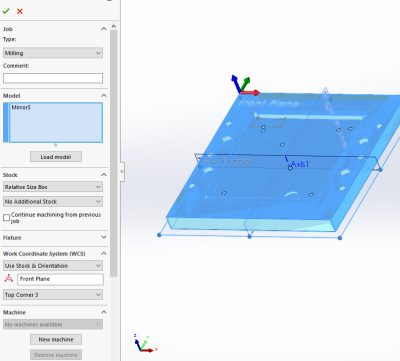
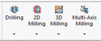
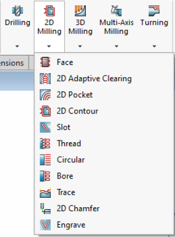
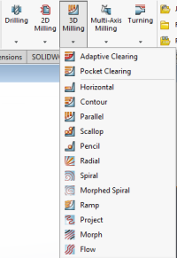
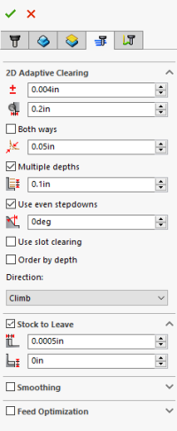

# Haas Super Mini Mill Training SOP

## Overview

This training introduces the use and operation of the Haas CNC mill, including:

- Software: SOLIDWORKS and HSMWorks
- File types and G-code
- Tool selection and feeds and speeds
- Job setup
- Machine limitations
- Machine maintenance

## Safety

- Wear safety glasses when the machine is running.
- Close the machine doors before starting a job.
- Allow the spindle to stop completely before adjusting or removing a workpiece or tool.
- After machining, remove sharp burrs from the workpiece using a hand file or sandpaper.

## Software

### CAD

This SOP focuses on SOLIDWORKS and assumes basic familiarity with the software. Users taking this training should have completed ME-12S or have comparable machining knowledge.

### CAM

This SOP focuses on HSMWorks, which integrates with SOLIDWORKS to create machining toolpaths.

The original document lists HSMWorks as installed on Innovation Workshop computers running SOLIDWORKS 2020, including the Ultimaker, Carbide 3D, and laser cutter computers.

> **REVIEW REQUIRED:** Confirm current software versions and computer availability.

Multiple toolpaths may be necessary to machine a complete part.

### 1. Open HSMWorks

Select the **CAM** tab in the SOLIDWORKS CommandManager.

HSMWorks is a separate plug-in from SOLIDWORKS CAM and SOLIDWORKS CAM TBM. Its CAM tab will not appear unless HSMWorks is installed and enabled.

The CommandManager will display the HSMWorks functions.

### 2. Create a New Job

Select **New Job** to:

- Select the part to machine.
- Define the raw stock dimensions.
- Specify the work coordinate system and part zero.

The source example uses the back-left corner for part zero.

### 3. Select a Machining Operation

Choose the desired operation from the **2D** or **3D** machining menu.

**2D operations** include slotting, facing, pocketing, and chamfering.

**3D operations** include adaptive clearing and machining that requires simultaneous motion along all three axes.

### 4. Configure the Operation

#### Tool and Cutting Parameters

- Select a tool from the tool library.
- Edit the tool definition as necessary to match the actual cutter and holder, including flute count, geometry, and stickout.
- Verify the feeds and speeds for the actual machine, tool, material, and operation.

> **REVIEW REQUIRED:** The original document links to a Nomad feeds-and-speeds chart and discusses router rigidity. Replace this reference with workshop-approved guidance for the Haas. Do not treat the original chart as verified Haas cutting data.

#### Machining Geometry

- Select the face or feature to machine.
- Disable **Z propagation** or **tangent propagation** when necessary to select smaller or partial features.
- When using **rest machining**, verify that the previous-tool or remaining-stock settings match the preceding operation.

#### Cutting and Retract Heights

- Selecting machining geometry may automatically populate some heights.
- Review all cutting, clearance, and retract heights and adjust them as necessary.

#### Machining Passes

- Review automatically populated cutting parameters.
- Set stepdowns and multiple passes appropriate to the setup.
- Adjust **Stock to Leave** when creating roughing passes.
- Check whether an operation leaves stock by default before relying on it for final dimensions.

> **REVIEW REQUIRED:** The original stepdown guidance refers to the limited power and rigidity of a different machine. Confirm Haas-specific guidance with the instructor.

#### Linking

Linking settings control how the cutter enters and exits the workpiece.

Review these moves to ensure the cutter does not unintentionally contact the stock when starting or finishing a cut.

### 5. Simulate the Toolpaths

- Select the entire job or an individual operation.
- Select **Simulate** from the HSMWorks toolbar.
- Review tool motion and material removal for unwanted cuts or potential collisions.
- Toggle the stock display to inspect material removal.

### 6. Post-Process the Program

> **REVIEW REQUIRED:** The original document specifies **Carbide 3D (grbl)** as the post configuration. This is a router instruction and must not be used as the Haas posting procedure.

The instructor must provide the approved:

- Haas post-processor and configuration
- Program naming or numbering convention
- Output file format
- Program transfer procedure

Select the output folder deliberately so the posted program can be located easily.

## Setting Up the Haas Mill for a Job

The original document describes CAT 40 tool holders for collet holders, drill chucks, and probes.

It also lists a typical arrangement of a 1/2-inch end mill in Tool 1 and a Renishaw probe in Tool 8.

> **REVIEW REQUIRED:** Confirm the machine's tooling specifications and current tool assignments. Do not assume the listed tool numbers match the current setup.

### Changing Tools

> **REVIEW REQUIRED:** Have the instructor verify this sequence against the installed Haas control and tool changer before use. In particular, confirm the correct tool-release control and required tightening specifications.

1. Select **MDI** mode using the **MDI/DNC** button.
2. Use **ATC Forward** or **ATC Reverse** to bring the desired tool into the spindle.
3. Support the tool holder before operating the instructor-identified tool-release control.
4. Remove the released tool holder.
5. Secure the holder in the CAT 40 tool-tightening fixture mounted in a vise.
6. Use the appropriate wrench to loosen the collet nut or tool-clamping mechanism.
7. Clean the collet tapers and tool shank before installing the replacement tool.
8. Tighten the collet nut or retaining mechanism to the applicable tooling specification.
9. Verify the pull stud using the instructor-approved inspection and tightening procedure.
10. Reinstall the holder using the instructor-approved spindle-loading procedure, ensuring correct alignment and retention.

## Choosing Tools

Tools are optimized for different materials and operations. A two-flute end mill may perform many operations but is not always the best choice.

The original document discusses:

- Single- and two-flute high-helix end mills for plastics, wood, and composites
- Carbide end mills and burrs for abrasive materials

> **REVIEW REQUIRED:** Confirm permitted materials and appropriate tooling for this Haas before using the examples above.

**Approved feeds-and-speeds reference:** TO BE ADDED.

## File Types

The source describes G-code files with the `.nc` extension. These files can be opened in a text editor for inspection.

> **REVIEW REQUIRED:** Confirm the required file format and transfer method for the installed control. The original overview also lists `.EGC` without explaining its use.

## Test Part

Training focuses on machine setup and operation rather than detailed CAM instruction.

Before training, review the files and practice creating toolpaths for the [training test part](https://drive.google.com/drive/folders/1tIQK6wZ0pye2SwnreKSnFAT9z5EiAgyl?usp=sharing).

- Use the `.step` file to create the CAM.
- Reference CAM is stored in the `.SLDPRT` file under the HSMWorks workspace.
- Contact the Workshop Wizard conducting the training if you need help creating the G-code.

Your program will be used during training to demonstrate your understanding of machine setup and operation.

---

# Haas Super Mini Mill Quick Review

**Tool lead listed in original SOP:** Marcos Gutierrez  
**Contact:** [marcos150@ucsb.edu](mailto:marcos150@ucsb.edu)

> Confirm that the tool lead and contact information are current.

## Safety Concerns

- Wear safety glasses when the machine is running.
- Close the machine door before starting a job.
- Allow the spindle to stop completely before adjusting or removing a workpiece.
- Remove sharp burrs after machining using a hand file or sandpaper.

## Operating Procedures Review

> This checklist supplements instructor-led training. The incomplete setup and operating procedures above must be resolved before this document is used as a standalone SOP.

1. Program and simulate the toolpaths.
2. Post the program using the approved Haas post-processor.
3. Install the cutting tools in their holders.
4. Set and verify tool offsets using the approved probing procedure.
5. Secure the stock and establish the work offset, usually **G54**, using the approved procedure.
6. Load the program.
7. Verify that the program's tool numbers match the tools installed in the machine.
8. Verify that the program uses the intended work offset.
9. Have the instructor review the setup before proving out the program.
10. Prove out the program using the workshop-approved procedure.
11. Use rapid override, feed override, and single-block mode as instructed when checking initial movements.
12. Remain ready to stop the machine if unexpected motion occurs.
13. Verify that any temporary changes made during prove-out have been restored before machining.
14. Run the program while monitoring for unexpected behavior.

> **REVIEW REQUIRED:** The original document suggests temporarily changing the G54 Z value for air cuts. A verified, machine-specific prove-out procedure must be supplied by the instructor before this technique is included as an operating instruction.

## Post-Processing

- Deburr the finished part using a file.

## Maintenance

- Tools should be wiped clear of chips or coolant using an acid brush
- The router should be vacuumed out after every operation and at the completion of each job
- Once a month the router should be moved and chips cleared from underneath machine body
- Twice a year the router should be partially disassembled, cleaned, and re-oiled
- Tool should undergo initial set up every time it is moved or lifted
---
